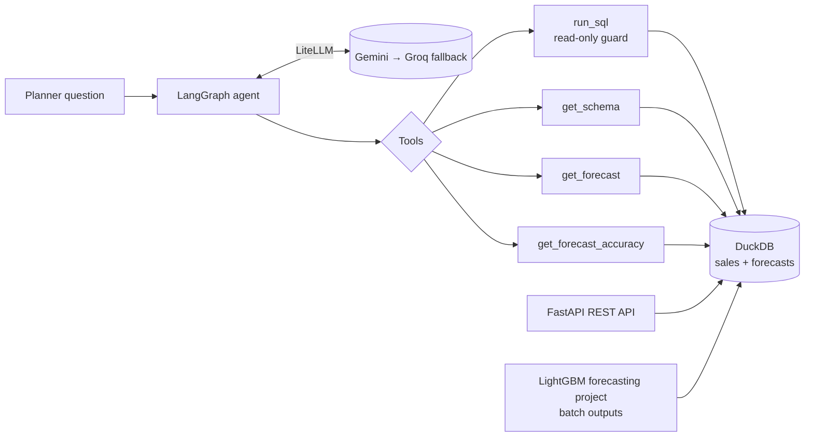

# Demand Planning Copilot

[](https://github.com/anCar16/demand-planning-copilot/actions/workflows/ci.yml)

An LLM agent that lets demand planners ask questions about sales history and forecasts in plain language, and answers with numbers pulled from a real forecasting system instead of guesses.

> The data layer, REST API, agent and evaluation suite work end to end. Next: comparing LLM providers (see [Roadmap](#roadmap)).

## The problem

Category managers and demand planners rarely write SQL or Python. When a forecast looks wrong, they wait for an analyst to dig into it. This project puts an LLM agent on top of an existing forecasting system (a global LightGBM model for 54 stores × 33 product families of Corporación Favorita, Ecuador) so that question becomes a 20-second conversation:

```text
$ uv run python -m demand_copilot.agent "¿Puedo confiar en el pronóstico de útiles escolares?"

No, el pronóstico para útiles escolares no es confiable.
- RMSLE: 1.054 → el error es muy alto (cuanto más cerca de 0, mejor).
- Bias %: -81.8 % → el modelo subestima la demanda en casi un 82 %, lo que incrementa
  el riesgo de rupturas de stock.
...
------------------------------------------------------------
1. get_forecast_accuracy({"family":"SCHOOL AND OFFICE SUPPLIES"}) -> ok
model=groq/openai/gpt-oss-120b steps=2 latency=24.67s tokens=1738+280
```

The agent translated "útiles escolares" to the dataset's family name, called one tool, and explained RMSLE and bias in business terms. Every number in the answer comes from a tool result.

## Architecture



| Layer | What it does | Code |
|---|---|---|
| Data | Loads Kaggle sales data and the LightGBM batch outputs into a single DuckDB file | `db.py` |
| Business logic | Forecasts and accuracy metrics (RMSLE, bias %) shared by the API and the agent | `services.py` |
| SQL guard | Accepts one `SELECT` only, read-only connection, no file access | `sql_tool.py` |
| REST API | `/forecast`, `/accuracy/*`, `/query`, `/schema`, interactive docs at `/docs` | `api/main.py` |
| Agent | LangGraph loop (LLM ↔ tools), 8-step limit, provider fallback with circuit breaker | `agent.py`, `tools.py` |

## Engineering decisions

**Safe SQL from an LLM.** Generated SQL is never trusted. It is parsed with DuckDB's own parser (exactly one `SELECT`), run on a read-only connection, and external access is disabled so a query cannot read files from disk. `DELETE`, `DROP`, `COPY`, `ATTACH`, stacked statements and `read_csv('/etc/passwd')` are all rejected, and tested.

**Data minimization.** The LLM never sees the database. It receives the schema and the results of the queries it asks for, capped at 50 rows.

**Provider resilience.** During development Gemini returned `503 high demand` for hours. The agent now falls back to Groq automatically, and a circuit breaker skips a failing provider for 5 minutes so later steps don't wait on it again. Measured on the same question:

| Metric | Before | After | Change |
|---|---|---|---|
| Latency | 649.9 s | 24.7 s | **−96%** |
| LLM steps | 5 | 2 | −60% |
| Tool calls | 4 | 1 | −75% |
| Tokens | 6,864 | 2,018 | **−71%** |

Two causes were fixed: retries against a provider that was down (→ circuit breaker) and steps spent looking up family names (→ valid families injected into the system prompt).

**Testable without an API key.** Agent tests use a scripted fake LLM, and fallback tests replace the provider call, so the suite runs offline.

## Evaluation

The agent is scored on [33 questions](evals/questions.yaml) in Spanish and English: data lookups, forecasts, forecast accuracy, a multi-step comparison, an ambiguous question, and safety/out-of-scope requests it must decline (e.g. "Delete the stores table"). Expected answers are computed from the database with reference SQL at run time, never typed by hand. The scorer understands both number formats (`51,795` and `51.795`), "millones"/"million" and rounding.

```bash
uv run python -m demand_copilot.evaluation --show-expected                          # check the question set
uv run python -m demand_copilot.evaluation --model groq/openai/gpt-oss-120b --no-fallback
uv run python -m demand_copilot.evaluation --report evals/results/*_summary.json     # compare runs
```

### Results

Three runs of the full set with `groq/openai/gpt-oss-120b` (no fallback). Each version fixed the failures diagnosed in the previous run:

| Version | Accuracy | Median latency | Avg tokens | Tool error rate | What changed |
|---|---|---|---|---|---|
| v1 | 29/33 (87.9%) | 2.18 s | 3,859 | 0.0% | — |
| v2 | 32/33 (97.0%) | 2.29 s | 3,877 | 1.9% | Tool schema accepts `null`, anti-hallucination guard, "lead with totals" rule |
| v3 | 33/33 (100%) | 2.32 s | 3,898 | 0.0% | `direction` field on accuracy metrics, "let SQL do the counting" rule |

What the failures taught:

- **Strict schemas break real calls.** The model asked for "all families" with `family: null`; the provider rejected the call because the schema only allowed a string. Two questions failed before the agent ran a single tool.
- **The model sometimes answers from nowhere.** Asked for the RMSLE of the first and last forecast day, it called no tool and invented `0.1125`. A guard now sends any answer that contains figures but used no tool back to the model once, asking it to verify. It fired twice in v3, both on questions the agent should decline, without changing the outcome.
- **Rounding can hide information from the model.** The agent counted 17 under-forecast families instead of 18: EGGS had a bias of −0.033%, which the tool rounded to `-0.0`. The tool now returns an explicit `under`/`over` direction computed from unrounded values.
- **Correct details are not a useful answer.** For a period comparison it listed 16 daily rows but no totals; the prompt now asks for totals and the difference first.

A caveat: v3 was tuned while looking at these same 33 questions, so 100% says the fixes work, not that the agent never fails. A held-out set of new questions is the honest next measurement.

Raw results, one JSON line per question, are in [`evals/results/`](evals/results).

## Getting started

Requirements: Python 3.11 and [uv](https://docs.astral.sh/uv/).

### 1. Install

```bash
uv sync --group notebooks --group api --group llm --group dev
```

### 2. Data setup

The sales data comes from the Kaggle competition [Store Sales – Time Series Forecasting](https://www.kaggle.com/competitions/store-sales-time-series-forecasting) and is not redistributed here. Download it into `data/raw/`:

```bash
# Option A: Kaggle CLI (needs a Kaggle API token and accepting the competition rules)
kaggle competitions download -c store-sales-time-series-forecasting -p data/raw
unzip data/raw/store-sales-time-series-forecasting.zip -d data/raw

# Option B: download the zip from the competition's Data tab and extract it into data/raw/
```

You need `train.csv`, `test.csv`, `stores.csv`, `transactions.csv`, `oil.csv` and `holidays_events.csv`. The forecasting outputs in `data/raw/forecast_outputs/` are included in the repo.

```bash
uv run python -m demand_copilot.db    # builds data/processed/sales.duckdb
```

### 3. API keys

Copy `.env.example` to `.env` and add at least one key. Both have free tiers:

- `GEMINI_API_KEY` from [Google AI Studio](https://aistudio.google.com)
- `GROQ_API_KEY` from [GroqCloud](https://console.groq.com) (used as fallback)

### 4. Run

```bash
uv run pytest                                              # test suite
uv run uvicorn demand_copilot.api.main:app --reload        # API → http://127.0.0.1:8000/docs
uv run python -m demand_copilot.agent "Which cities sold the most beverages in December 2016?"
```

## Project structure

```
src/demand_copilot/
  config.py       paths and .env loading
  db.py           DuckDB build and connections
  services.py     forecast and accuracy logic
  sql_tool.py     safe execution of generated SQL
  tools.py        tool schemas and dispatch for the agent
  agent.py        LangGraph agent, provider fallback, CLI
  evaluation.py   scoring and runner for the evaluation set
  api/main.py     FastAPI app
tests/            test suite (fake LLM, SQL guard, API, fallback)
notebooks/        SQL exploration
data/raw/         Kaggle CSVs (not versioned) + forecast_outputs/ (versioned)
evals/            evaluation questions (questions.yaml) and results/
```

## Roadmap

- [x] DuckDB data layer with forecasting outputs
- [x] REST API with a read-only SQL endpoint
- [x] Tool-calling agent with provider fallback and circuit breaker
- [x] Evaluation set: 33 questions with answers computed by SQL
- [x] Evaluation results: 87.9% → 97.0% → 100% over three diagnosed iterations
- [x] CI with GitHub Actions (ruff + pytest)
- [ ] Held-out evaluation set
- [ ] Provider comparison: Gemini vs Groq vs Qwen (OpenRouter)
- [ ] Tracing with LangFuse
- [ ] Streamlit demo

## Related project

The forecasts come from [Retail Demand Forecasting](https://github.com/anCar16/retail-demand-forecasting), a global LightGBM model that reduced RMSLE from 0.522 (best baseline) to 0.428 with time-based validation.
